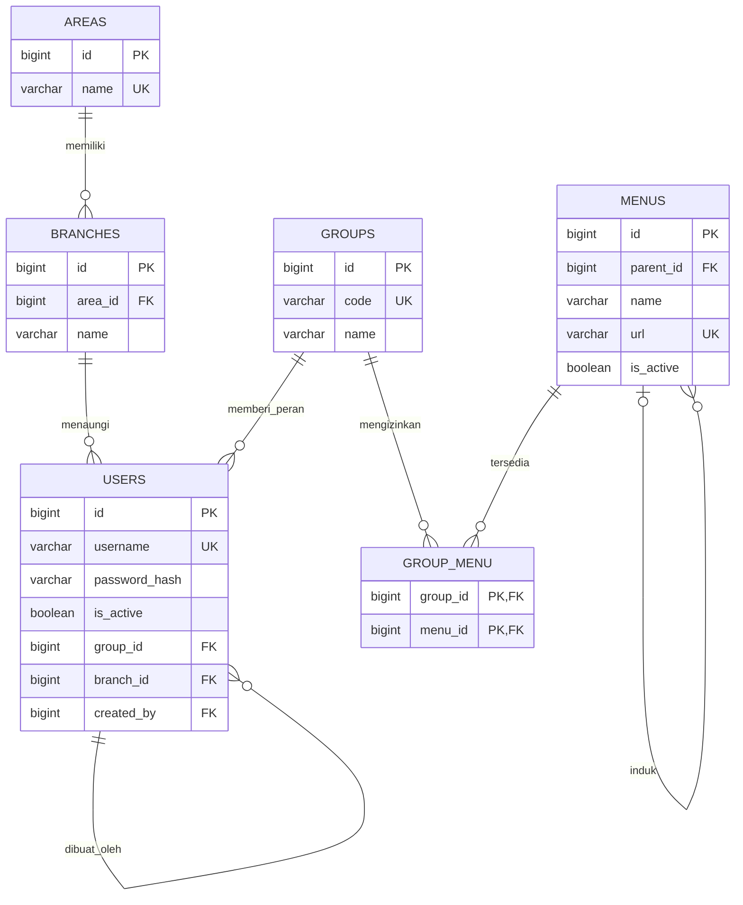
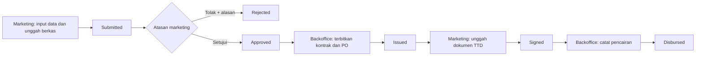

# Jawaban Tes Coding 2025

Sumber: `Soal Tes Coding 2025.pdf` (dua halaman). Implementasi berada di folder Laravel ini. Soal nomor 2 pada halaman kedua meminta salah satu dari 2.a atau 2.b; jawaban ini memilih **2.a** karena proses yang didigitalisasi mencakup lebih dari input dan approval.

## Halaman 1 — normalisasi database

### 1. Kesalahan pada diagram asal

| Bagian | Masalah | Perbaikan |
| --- | --- | --- |
| `Master_User.idarea` | Area sudah ditentukan oleh `idcabang` lewat `Master_Cabang.id_area_cabang`. Dua sumber area dapat berbeda. | Simpan `branch_id` saja pada user; area didapat lewat cabang. |
| `Master_User.idmenu` | Hak menu sudah tersedia melalui `idgroupuser` dan `Mapping_GroupMenu`. Kolom langsung pada user membuat aturan akses ganda dan mengesankan satu menu per user. | Hapus `idmenu` dari user; akses melalui grup dan tabel penghubung. |
| `Master_User.createdby varchar(100)` | Identitas pembuat disimpan sebagai teks sehingga bisa salah eja atau merujuk user yang tidak ada. | `created_by` sebagai FK nullable ke `users.id`. |
| `Master_User.username` | Diagram tidak menyatakan PK atau keunikan username. Nama login dapat berubah dan kurang aman sebagai FK. | Tambah `users.id` sebagai PK dan `username` unik. |
| `Master_User.password varchar(6)` | Panjang enam karakter tidak cukup untuk hash kata sandi dan mengarah ke penyimpanan plaintext. Ini masalah desain keamanan, walau bukan pelanggaran bentuk normal. | Simpan hash pada `varchar` yang memadai; Laravel melakukan hashing. |
| `Master_User.statusUser varchar(10)` | Nilai bebas menimbulkan variasi `aktif`, `Aktif`, dan sebagainya. | `is_active boolean` dengan default dan validasi. |
| `Master_Menu.parent_menu` | Hubungan induk menu belum jelas sebagai FK ke menu yang sama; root juga memerlukan `NULL`. | `parent_id` nullable FK ke `menus.id`. |
| `Mapping_GroupMenu` | Kombinasi `idgroup, idmenu` tidak ditunjukkan sebagai PK/unik; hak akses bisa tercatat dua kali. | Composite PK `(group_id, menu_id)` dan dua FK. |
| Seluruh tabel master | PK, FK, `NOT NULL`, indeks, serta aturan hapus tidak dinyatakan eksplisit pada gambar. Tanpanya, baris yatim dan duplikat mungkin terjadi. | Tetapkan constraint pada migrasi. |
| Nama dan relasi | `idgroupuser`, `idgroup`, `id_area_cabang`, dan `idarea` tidak konsisten; menyulitkan pemetaan FK. | Gunakan nama yang seragam: `group_id`, `branch_id`, `area_id`. |
| `createddate datetime` | Tidak jelas zona waktu dan siapa yang mengisi nilai. | `created_at` dan `updated_at` dari Laravel, disimpan konsisten oleh aplikasi. |

`nama_group`, `nama_menu`, dan `nama_area` tidak wajib unik secara teori normalisasi; keunikannya adalah keputusan bisnis. Satu grup per user mengikuti diagram asal. Jika pengguna harus memiliki beberapa grup, tambahkan `user_group` sebagai tabel penghubung.

### 2. ERD hasil normalisasi



Nama tabel fisik aplikasi memakai bentuk jamak Laravel (`areas`, `branches`, `groups`, `users`, `menus`, `group_menu`). Kata sandi pada tabel fisik bernama `password` dan berisi hash, bukan plaintext. Relasi `created_by` tersedia pada skema sebagai FK opsional. Skema aplikasi juga menambahkan tabel pengajuan kredit, konsumen, dokumen, riwayat, dan pencairan untuk soal halaman kedua.

### 3. View PostgreSQL untuk tiga laporan

Ketiga view di bawah dibuat otomatis oleh migrasi `database/migrations/2026_10_21_000001_create_credit_workflow.php` saat koneksi PostgreSQL digunakan.

```sql
CREATE VIEW active_users AS
SELECT u.id, u.username, u.name, g.name AS group_name,
       b.name AS branch_name, a.name AS area_name
FROM users u
JOIN groups g ON g.id = u.group_id
JOIN branches b ON b.id = u.branch_id
JOIN areas a ON a.id = b.area_id
WHERE u.is_active = true;
```

```sql
CREATE VIEW user_menu_access AS
SELECT u.id AS user_id, u.username, g.name AS group_name,
       m.id AS menu_id, m.name AS menu_name, m.url, m.parent_id
FROM users u
JOIN groups g ON g.id = u.group_id
JOIN group_menu gm ON gm.group_id = g.id
JOIN menus m ON m.id = gm.menu_id
WHERE u.is_active = true AND m.is_active = true;
```

```sql
CREATE VIEW active_user_count_per_area AS
SELECT a.id AS area_id, a.name AS area_name,
       COUNT(u.id) AS active_user_count
FROM areas a
LEFT JOIN branches b ON b.area_id = a.id
LEFT JOIN users u ON u.branch_id = b.id AND u.is_active = true
GROUP BY a.id, a.name;
```

`LEFT JOIN` mempertahankan area tanpa cabang atau user aktif sehingga jumlahnya tampil `0`. Filter status user diletakkan pada kondisi `JOIN` agar area kosong tidak hilang.

## Halaman 2 — digitalisasi pengajuan kredit

### 1. Bagian proses manual yang dapat diperbaiki

| Langkah gambar | Perbaikan digital |
| --- | --- |
| 1. Deal konsumen dan sales dealer | Kesepakatan tetap berlangsung dengan pihak luar; data dealer dan kendaraan dimasukkan satu kali ke pengajuan. |
| 2–3. Sales dealer memberi info, marketing menghubungi konsumen dan mengumpulkan data | Form web menggantikan penyalinan ulang data. NIK, data keluarga, kendaraan, uang muka, tenor, dan angsuran divalidasi di server. |
| 4. Submit data dan berkas fisik | Marketing mengirim pengajuan beserta KTP, kartu keluarga, dan bukti tanda jadi sebagai berkas privat. |
| 5. Approval atasan marketing | Atasan melihat data dan dokumen pada halaman yang sama, lalu menyetujui atau menolak. Penolakan memerlukan alasan. |
| 6. Printing kontrak dan PO | Backoffice menerbitkan ringkasan kontrak dan PO dari data pengajuan yang disetujui, lalu mencetaknya bila perlu. |
| 7. Tanda tangan konsumen/dealer | Tanda tangan fisik tetap dapat dilakukan; marketing mengunggah hasil scan sehingga berkasnya tercatat. Integrasi tanda tangan elektronik tidak diasumsikan. |
| 8. Upload dokumen TTD | Unggahan tersimpan dengan jenis dokumen, pengunggah, dan waktu. |
| 9. Pencairan dana | Backoffice mencatat nilai pembiayaan, tanggal, dan nomor referensi unik setelah dokumen TTD tersedia. Aplikasi ini tidak mengeksekusi transfer bank. |

### 2. Rancangan alur digital



Setiap perpindahan status memeriksa peran dan status sebelumnya di backend. Riwayat perubahan menyimpan pelaku, waktu, tindakan, serta catatan keputusan. Dokumen hanya bisa diunduh oleh pihak internal yang berwenang atau marketing pemilik pengajuan.

### 2.a. Program web

Program yang dibuat menggunakan **Laravel 13 + Vue 3 + PostgreSQL** dalam satu proyek. Laravel menangani autentikasi berbasis sesi, validasi, izin peran, penyimpanan berkas privat, transaksi database, dan view laporan. Vue menangani halaman login, daftar, formulir, detail pengajuan, laporan, serta cetak dokumen. Tidak ada frontend terpisah.

Tabel aplikasi: `customers`, `credit_applications`, `application_documents`, `application_events`, dan `disbursements`. Semua terhubung ke tabel pengguna dan cabang yang sudah dinormalisasi. `disbursements.credit_application_id` unik agar satu pengajuan hanya bisa dicairkan sekali. Nilai pencairan contoh dihitung sebagai harga kendaraan dikurangi uang muka; perhitungan kredit formal memerlukan aturan produk yang tidak diberikan dalam soal.

### 2.b. Alternatif yang tidak dipilih

Soal menyatakan nomor 2 hanya mengerjakan salah satu jalur. Karena 2.a dipilih dan programnya dibuat, 2.b tidak menjadi keluaran terpisah. Fungsi input pengajuan dan approval yang diminta 2.b sudah tercakup dalam 2.a.
